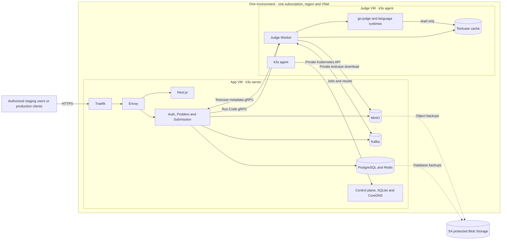

# ADR-0004 — Azure topology and subscription layout

| Field | Value |
|---|---|
| Status | Proposed |
| Date | 2026-11-25 |
| Milestone | M0-09 |
| Requirements | NFR-F01–F03, NFR-D01–D07, NFR-A01–A03/A06, NFR-R01/R02/R07/R08, NFR-S05/S08/S09 |
| Implementation | M0-13 cloud and delivery baseline, M0-14 observability baseline, M2-08 backup and recovery |
| Review | Orchestrator, infrastructure and service owners through the [ADR review process](../../process/workflow.md#10-adrs) |

## Context and decision drivers

AstraCode will provision its Azure environments from scratch. The checked-in Compose configurations and GitHub
Actions workflows provide a local development stack and a reference dual-node deployment path. They establish
workload and release requirements for the new design. The team reports five Azure for Students subscriptions,
each with USD 100 unused, a one-year credit validity from activation and unused quotas. Each subscription has its
own balance and can exhaust it before the validity period ends. Subscription access, remaining balance and quotas
need verification before provisioning. [Azure for Students FAQ](https://learn.microsoft.com/en-us/azure/education-hub/faq) ·
[Subscription disablement](https://learn.microsoft.com/en-us/azure/cost-management-billing/manage/azurestudents-subscription-disabled)

The design prioritizes a reproducible two-node deployment, independent environment lifecycles, a dedicated host
for privileged execution and low recurring cost. Keep existing service and database ownership, the Submission
transaction and outbox, the Kafka contracts and attempt-aware result handling. Official submissions use Kafka.
Run Code uses synchronous Submission-to-Worker gRPC and does not enter the official queue. The team has already
tested go-judge and retains it as the executor. [Current runtime boundaries](../../codebase/ARCHITECTURE.md) ·
[Execution flows](../../codebase/FLOWS.md) · [Data ownership](../../codebase/DATA.md)

## Options

| Option | Trade-off |
|---|---|
| **Two Azure VMs per environment with k3s and self-hosted dependencies (selected)** | Separates application and judge host resources, preserves current images and adds standard scheduling and rollout primitives. The team operates the control plane and backing services and accepts single points of failure. |
| One VM for control plane, application and judge | Reduces compute cost and host operations. Compilers and privileged execution share the data host's kernel and compete with all application workloads. |
| Two VMs with Docker Compose in Azure | Reuses the reference operating model. Placement, multi-node rollout and readiness across the two hosts remain script-managed. Compose remains the development workflow. |
| Managed Kubernetes, managed backing services or a redundant cluster | Reduces some operator work or adds redundancy, with higher cost or operational complexity for this budget. |

## Decision

### Platform and subscriptions

Use Microsoft Azure, Terraform for provisioning, cloud-init for VM bootstrap, and k3s with its bundled containerd.
Use Docker Compose locally, GitHub Actions for CI/CD, GitHub Container Registry (GHCR) for images and Kustomize for
Kubernetes manifests. Version-control provisioning, bootstrap and deployment configuration. Azure Blob Storage
holds Terraform state, Azure Key Vault holds runtime secrets, and Azure Managed Disk backs local persistent
volumes through k3s Local Path Provisioner. Ubuntu 24.04 LTS x86-64 is the initial OS candidate.

| Logical subscription | Responsibility |
|---|---|
| **S1 — Production** | Independent App/Judge k3s cluster serving real users. Continuous operation begins in M3. |
| **S2 — Staging** | Independent App/Judge k3s cluster used by authorized project members during owner-approved, on-demand sessions. Both VMs deallocate after each session. |
| **S3 — Testing** | Temporary Azure environments for VM sizing, Terraform experiments, k3s validation, benchmarks, contest load and judge scaling. Size and topology vary by experiment. Release unused resources after each experiment. |
| **S4 — Shared operations** | Separately managed Azure Blob Storage for Terraform state and external database, object storage and recovery artifacts. No dedicated VM. |
| **S5 — Reserve and disaster recovery** | Cold standby with no continuously running VMs. First replacement candidate for S1. |

S1–S5 are logical names. Keep credentials and subscription identifiers out of the documentation. Use independent
Terraform state keys and lock scopes per environment, with separate state for shared operations and production
recovery targets. Use the AzureRM backend's native Blob state locking. Manage the S4 backend and backup storage on
a lifecycle independent of environment compute. Restrict access to state and backups separately, avoid public
exposure, and keep state out of Git. Before provisioning, verify Microsoft Entra tenant membership or approved
cross-tenant access, workload identity federation, subscription/resource scopes and Blob data-plane RBAC for each
identity. Verify that provisioning in the target subscription and state access in S4 work together without
broadening either scope. [Terraform AzureRM backend](https://developer.hashicorp.com/terraform/language/backend/azurerm)

### Cluster and workload placement

Staging and production use the same logical topology. Each has its own subscription, VNet, cluster and data.
Each starts with exactly two VMs in one Azure region and uses single-instance workloads by default.

| Node | Placement |
|---|---|
| **App VM** | k3s server and schedulable application node. Runs the control plane with embedded single-server SQLite, CoreDNS, Traefik, Next.js, Envoy, Auth, Problem, Submission, PostgreSQL, Kafka, Redis and MinIO. |
| **Judge VM** | Dedicated k3s agent. Runs Judge Worker, the go-judge executor with compiler/runtime dependencies, and the local testcase cache. |

Label both node roles, taint the Judge node and grant that toleration only to judge workloads and required node
agents. Apply required node affinity to pin App workloads and Judge workloads to their respective roles. Confine
packaged Traefik and its ingress exposure to App. Verify scheduling and ingress behavior for the k3s add-ons as
well as the application manifests. [k3s datastore options](https://docs.k3s.io/datastore) ·
[k3s networking services](https://docs.k3s.io/networking/networking-services)

### Networking and security

- Use private IPs for cluster traffic within each VNet. Apply Azure NSGs to restrict k3s node and control-plane
  traffic, including TCP 6443 to the server and Flannel VXLAN UDP 8472 between trusted nodes only. Keep the
  Kubernetes API and SSH off the public Internet. [k3s networking requirements](https://docs.k3s.io/installation/requirements)
- Use default Flannel VXLAN, built-in NetworkPolicy enforcement and Kubernetes Services with CoreDNS. VXLAN
  leaves inter-node Pod traffic unencrypted. This is an initial trade-off subject to the security requirements.
  Validate internal transport requirements against the existing plaintext gRPC and the official-testcase trust
  boundary before public use. The Azure design excludes WireGuard, VPN infrastructure, a custom CNI and a
  service mesh.
  [Existing trust boundaries](../../codebase/TECH_DEBT.md) · [k3s networking services](https://docs.k3s.io/networking/networking-services)
- Expose HTTPS on the App VM through Traefik and retain Envoy as the application gateway for API routing, JWT
  validation and trusted identity headers. Keep the same-origin UI/API/SSE/avatar routes, with no external path
  to protected services that bypasses Envoy. Keep PostgreSQL, Kafka, Redis, MinIO, go-judge and internal HTTP/gRPC
  endpoints private. Staging ingress must be restricted to authorized members during an approved session.
- Scope NetworkPolicies to required workload paths, including ingress-to-Envoy, Envoy-to-backends, Submission-to-
  Worker Run Code, Worker-to-Problem metadata, Kafka and private MinIO testcase downloads. Keep the executor
  reachable only by its Worker and preserve the read-only testcase mount and code-execution limits. Node
  placement reduces co-location risk. The agent, kernel, network and cluster control plane remain shared trust
  boundaries for privileged execution. On Azure/k3s, validate the privilege model, host access, cgroups, CPU,
  memory, process, time and output limits, volume/tmpfs access and denial of networking to submitted code.
  Verify that submitted code cannot reach Azure instance metadata or obtain node credentials.
- Configure explicit Azure outbound paths for both VMs. App needs DNS and time synchronization, approved OS and
  k3s package sources, GHCR and required base-image registries, Key Vault and the S4 backup endpoint as
  authorized, plus application dependencies such as SMTP and certificate renewal when used. Judge needs
  DNS/time, approved OS and k3s sources and image pulls. Compiler packages belong in the sandbox image build.
  Worker access to Kafka, Problem and MinIO stays private, and node egress must remain unavailable to untrusted
  executions. M0-13 selects and verifies the explicit outbound mechanism, routes, destinations, costs and
  workload restrictions. Provisioning must work with Azure default outbound access disabled.
  [Azure outbound connectivity](https://learn.microsoft.com/en-us/azure/virtual-network/ip-services/default-outbound-access)
- Use Key Vault with least-privilege runtime secret access and a separate identity per operational purpose.
  Inject secrets at runtime. Keep credentials out of Git, images, Terraform configuration, rendered cloud-init,
  logs and release artifacts. Avoid materializing secrets in Terraform state and protect any sensitive state
  that remains. M0-13 verifies secret retrieval, rotation and access to protected GHCR images.
- Judge must join using a dedicated agent-only token or a short-lived agent bootstrap token. Configure the
  chosen mechanism explicitly because k3s defaults to the server token for agent joins. Keep the server token
  and administrator kubeconfig off Judge. Apply the secret-handling rules above to all k3s credentials and
  keep them out of Terraform state. M0-13 verifies secure delivery, access permissions, and expiry or
  rotation as applicable. [k3s token documentation](https://docs.k3s.io/cli/token)

### Region, VM and disk candidates

Prefer regions near Vietnam in this order: Southeast Asia (Singapore), Malaysia West, Indonesia Central, East
Asia (Hong Kong), Japan East or Japan West, Korea Central, India regions, then other eligible regions. Select
using subscription access, regional and VM-family quota, SKU availability, actual provisioning capacity,
pricing and measured latency. Both VMs in an environment stay in the same region. Terraform must allow selection
of the region, independent App/Judge VM sizes and all disk sizing parameters. Equivalent eligible SKUs are
acceptable. [Azure region list](https://learn.microsoft.com/en-us/azure/reliability/regions-list) ·
[Azure VM quotas](https://learn.microsoft.com/en-us/azure/virtual-machines/quotas)

| Node | Target | Staging candidates in preference order | Production candidates in preference order |
|---|---|---|---|
| App | 2 vCPU, 8 GiB | `Standard_B2as_v2`, `Standard_B2s_v2` | `Standard_D2as_v5`, `Standard_D2s_v5`, `Standard_D2as_v6` |
| Judge | 2 vCPU, at least 4 GiB | `Standard_B2als_v2`, `Standard_B2ls_v2`, `Standard_D2ls_v5` | `Standard_D2ls_v5`, `Standard_D2als_v6`, `Standard_D2as_v5` if additional memory is needed |

Microsoft's specifications confirm the listed vCPU and RAM values. Access, actual capacity and affordability in
the team's subscriptions remain unverified. B-series accumulates CPU burst credits below baseline usage and
throttles to baseline when those credits run out. Azure Student monetary credits fund the Azure bill independently.
Prefer non-burstable SKUs for sustained judging when the budget permits, and test sustained load long enough to
observe any throttling. S3 sizes are flexible.
[Basv2](https://learn.microsoft.com/en-us/azure/virtual-machines/sizes/general-purpose/basv2-series) ·
[Bsv2](https://learn.microsoft.com/en-us/azure/virtual-machines/sizes/general-purpose/bsv2-series) ·
[Dasv5](https://learn.microsoft.com/en-us/azure/virtual-machines/sizes/general-purpose/dasv5-series) ·
[Dsv5](https://learn.microsoft.com/en-us/azure/virtual-machines/sizes/general-purpose/dsv5-series) ·
[Dasv6](https://learn.microsoft.com/en-us/azure/virtual-machines/sizes/general-purpose/dasv6-series) ·
[Dlsv5](https://learn.microsoft.com/en-us/azure/virtual-machines/sizes/general-purpose/dlsv5-series) ·
[Dalsv6](https://learn.microsoft.com/en-us/azure/virtual-machines/sizes/general-purpose/dalsv6-series)

| Standard SSD LRS disk | Staging | Production |
|---|---:|---:|
| App OS | 64 GiB | 64 GiB |
| App data | 64 GiB | 128 GiB |
| Judge OS | 64 GiB | 64 GiB |
| Judge data | None initially | None initially |

Keep PostgreSQL, Kafka, Redis persistence and MinIO on local persistent volumes backed by a separately managed
App data disk. Require the expected disk and mount before starting the provisioner or stateful workloads so a
missing disk cannot silently redirect writes to the OS disk. Protect the disk and PV data during routine
Terraform and Kubernetes operations, and rehearse reattachment and recovery of node-bound volume metadata
before relying on compute replacement. Include the k3s SQLite datastore and server token in protected recovery
artifacts when required to restore the cluster. The Judge testcase cache is disposable and starts on its OS
disk. Set cache and log growth bounds for both nodes and preserve the cache's active-reader safety when
reclaiming generations. [k3s local storage](https://docs.k3s.io/add-ons/storage) ·
[k3s backup and restore](https://docs.k3s.io/datastore/backup-restore) ·
[ADR-0003](0003-worker-testcase-cache-generations.md)

### Delivery and access control

- Pull requests run build, tests, lint, configuration validation and applicable security checks. Preserve
  existing CI coverage. Untrusted PRs receive no infrastructure, deployment or image-publishing privileges.
- Merges to `develop` run required checks and publish immutable release artifacts to GHCR. Use image digests
  for deployment. Record the source commit, all application image digests, migration artifact and version,
  Kustomize manifest revision, and CI and staging validation evidence. Supply environment-specific
  configuration at runtime so the same release can move between environments.
- Following approval from either deployment maintainer and within an owner-approved staging startup or session,
  GitHub Actions runs the chosen release's migrations, deploys its workloads, waits for readiness, runs smoke tests
  and records evidence. Publishing a release does not start or deploy to staging.
- Following approval from either deployment maintainer, production promotes the exact release validated in
  staging. Keep the `main` milestone-release and protected semantic-tag workflow. Tags reference the validated
  release metadata and digests. A `main` merge or tag must not rebuild or substitute images for production.
  Run migration, deployment, readiness and smoke checks automatically after approval and respect the contest
  freeze (NFR-A06).
- Run the official pinned Goose v3.30.0 CLI and each service's immutable, versioned PostgreSQL sequence in a separate
  migration step before activating applications that require the new version. Keep migration and runtime
  privileges separate. Review migrations for compatibility with the previous release and rehearse rollback
  to a compatible application version within NFR-D03. A failed migration stops activation. Any schema recovery
  needs a reviewed forward fix or restore plan, with no automatic destructive down migration.
  [Migration policy](0006-schema-migration-policy.md) · [Goose CLI and schema gate](0011-local-goose-migrations.md)
- Submission must run as a single active instance until replica-safe outbox delivery and multi-replica realtime
  behavior are implemented and verified. Use stop-before-start for rollouts and rollbacks. Verify that the
  previous instance and its outbox relay have terminated before starting the replacement. A rolling update can overlap
  Pods even with `replicas: 1`. M0-13 may use `Recreate` with an explicit termination check. A controlled
  interruption is acceptable. [Submission outbox and SSE limitations](../../codebase/TECH_DEBT.md#confirmed-from-codeconfiguration)
- Keep Terraform plan, review and approved apply separate from application delivery and staging lifecycle
  actions. Prefer GitHub Actions OIDC with scoped Azure identities for infrastructure, lifecycle and delivery.
  Use a controlled private deployment path to the cluster. M0-13 must verify the chosen transport and the
  repository plan's approval features, including role separation, requester/self-review and bypass
  settings. Keep the required gates enforced if the native features need a protected alternative.
  [GitHub deployment environments](https://docs.github.com/en/actions/how-tos/deploy/configure-and-manage-deployments/manage-environments) ·
  [GitHub OIDC with Azure](https://docs.github.com/en/actions/how-tos/secure-your-work/security-harden-deployments/oidc-in-azure)

The project owner and a second designated maintainer are the two deployment maintainers. One authorized
maintainer approval is the default for one deployment. Assign roles in protected configuration without
embedding personal account identifiers or credentials in the repository.

| Operation | Team member | Second maintainer | Project owner |
|---|:---:|:---:|:---:|
| Use an approved staging session | Yes | Yes | Yes |
| Request session startup or extension | Yes | Yes | Yes |
| Approve session startup or extension | No | No | Yes |
| Request deployment | Yes | Yes | Yes |
| Approve staging or production deployment | No | Yes | Yes |
| Manage infrastructure and approve apply | No | Yes | Yes |
| Approve rollback | No | Yes | Yes |

### Staging lifecycle

1. A project member requests a session. The owner approves startup. GitHub Actions starts both VMs and waits
   for k3s, both nodes and required services to pass readiness checks. First activation of an empty cluster
   requires a deployment approval during the bounded startup period, before tester access and the session timer.
2. Start the one-hour session at readiness and record its expiry. Boot and bounded shutdown can add billable
   time. Each extension requires a fresh request and owner approval. Deployment approval gives no authority
   to start staging or extend a session.
3. On expiry, close admission for new testing work. Allow in-flight work to finish or terminate it through a
   safe, bounded shutdown path. Deallocate both VMs automatically and confirm their Azure power state.
   Preserve disks and data. Routine shutdown uses VM deallocation and retains the Terraform-managed environment.

M0-13 implements the lifecycle with GitHub Actions and Azure CLI. Serialize session, deployment and migration
operations for the environment and track readiness/expiry outside the lifetime of any one workflow run.
Reject concurrent session requests and reject deployment or migration admission when the remaining window
cannot accommodate safe completion or cancellation. On expiry, stop new Run Code and official jobs and
reconcile in-flight attempts with durable Submission, outbox and Kafka state before shutdown. Keep partial
migration or deployment outcomes visible and require recovery before serving again. A bounded startup
deadline and independently retried expiry/cleanup path must handle partial starts, failed deploys, failed or
cancelled workflows, and partial deallocation. Alert maintainers if automatic cleanup cannot confirm both
VMs are deallocated. Honor the existing daily off-time floor in NFR-F03.

### Budget and recovery

Configure per-subscription alerts at 50%, 80% and 100% and review weekly burn rates. Alerts inform action.
Production runs continuously from M3. Staging is on demand, S3 resources are temporary and S5 has no standing
compute. Disks, public IP addresses, storage and selected networking resources can still incur charges when
VMs are deallocated. For a pre-provisioning sanity check, compare indicative eligible-region Linux VM,
disk, IP, outbound and storage rates with each subscription's balance and expected run hours. Update the
forecast with actual Azure cost and usage data after provisioning. NFR-F01 compliance and the affordability
of continuous production remain unproven.
[Azure Pricing Calculator](https://azure.microsoft.com/en-us/pricing/calculator/) ·
[Azure VM power states and billing](https://learn.microsoft.com/en-us/azure/virtual-machines/states-billing) ·
[Azure budget alerts](https://learn.microsoft.com/en-us/azure/cost-management-billing/costs/tutorial-acm-create-budgets)

In Southeast Asia, Microsoft listed standard on-demand Linux compute at USD 0.108/hour for `Standard_D2as_v5`
and USD 0.098/hour for `Standard_D2ls_v5` when checked on 2026-11-25. At those rates, both VMs running 24/7
would cost USD 148.32 in 30 days for compute alone, exceeding one USD 100 balance before disks, networking
or storage. Refresh rates and compare eligible alternatives before provisioning. This check uses public
retail rates and leaves effective offer pricing and actual usage to be verified.
[Azure Retail Prices API](https://learn.microsoft.com/en-us/rest/api/cost-management/retail-prices/azure-retail-prices) ·
[Southeast Asia retail meters](https://prices.azure.com/api/retail/prices?%24filter=armRegionName%20eq%20%27southeastasia%27%20and%20serviceName%20eq%20%27Virtual%20Machines%27%20and%20priceType%20eq%20%27Consumption%27%20and%20%28armSkuName%20eq%20%27Standard_D2as_v5%27%20or%20armSkuName%20eq%20%27Standard_D2ls_v5%27%29)

Keep daily backups of each owning database and object storage in S4. Preserve the required recovery artifacts
and rehearse access from a replacement subscription. Use forecast time-to-exhaustion, credit expiration and
rehearsed recovery lead time to prepare S1 replacement before credit runs out. Use S5 first, then S3 if
necessary. Keep S4 available for state and backups. Reusing S2 requires explicit approval as a last resort.
The recovery method is reprovisioning from Terraform with independent target state. It assumes neither
cross-subscription resource movement nor automatic failover.

For a planned migration, use an approved maintenance window outside contests. Stop new writes and judging
admission, drain or reconcile in-flight attempts and capture a consistent final recovery point. Account for
pending outbox rows, Kafka jobs, consumer state and unapplied results alongside databases and stored objects.
Deploy the same release into the replacement environment, restore protected data and configuration, verify
schemas, data, ingress and judging, and then perform DNS cutover. Keep the source write-fenced throughout
cutover so old clients cannot create conflicting writes. M2-08 owns detailed procedures and restore drills
against NFR-R07 (RPO ≤ 24 h) and NFR-R08 (RTO ≤ 4 h).

## Consequences

- Loss of App takes down the control plane, ingress, application and backing stores. An intact Judge may still
  have running processes but cannot provide complete judging without Kafka, metadata or result application.
  Recovery depends on the App disk and cluster recovery artifacts or an external restore.
- Loss of Judge interrupts official verdict processing and interactive Run Code. App-hosted journeys may
  continue and accepted official work may remain queued. Reconcile outbox, Kafka and pending attempts after
  recovery. The current relay/DLT limitations still apply. [Technical debt](../../codebase/TECH_DEBT.md)
- The design accepts maintenance windows and single points of failure. It has one control-plane server,
  one VM per role, local storage, single-instance databases and no automatic VM failover. This does not
  relax production SLOs, contest restrictions or submission integrity requirements. The team assumes the
  operational cost of patching, capacity management and testing recovery.
- M0-09 records the design. Terraform resources, k3s bootstrap, Kustomize manifests and deployment/lifecycle
  workflows belong to M0-13. Full observability, managed backing services, AKS, HA, distributed storage,
  GitOps controllers, autoscaling, and blue-green or canary rollout are outside this design scope.

## Validation and acceptance

| Pending evidence | Where to validate |
|---|---|
| Actual region access, eligible SKUs, family/region quotas and successful allocation; OS and pinned k3s compatibility; explicit node egress and scoped identities | M0-13 using temporary S3 experiments and eligibility checks in the target subscriptions |
| CPU/RAM by component at idle and representative load, incremental k3s overhead, disk utilization and growth, cache/retention limits and burst behavior | Proposed M0-13 sizing checkpoint in S3. One representative local Compose footprint can inform review but cannot substitute for Azure/k3s measurements. |
| Node placement and mount gates, private ingress and Envoy trust boundary, executor privileges, resource limits and network isolation | M0-13 target-environment validation |
| Release digests and approvals, schema migration and compatible rollback, staging readiness, concurrent requests, expiry, cancellation and verified deallocation | M0-13 walking skeleton and lifecycle rehearsal |
| Actual spend, credit runway and budget-alert delivery | Measure after M0-13 provisioning. M0-15 owns FinOps documentation. Review sustained production affordability before continuous M3 operation. |
| Baseline centralized logs, health and metrics | M0-14 |
| Judge scaling, throughput, latency and submission integrity under representative contest load | M2-06 and M2-07 on appropriately sized Azure/k3s infrastructure |
| Daily backup, consistent recovery, reserve subscription restore and cutover drills | M2-08, with production readiness and SLO evidence in M3 |

The [delivery plan](../../product/delivery-plan.md#m0--foundation) names a measured stack footprint for M0-09
and maps it to NFR-F01. This ADR addresses the design review. The footprint and measured affordability evidence
are pending, and M0-09 remains subject to its existing acceptance criteria. As an amendment for Orchestrator
review, allow M0-09 acceptance after ADR review and an indicative budget sanity check, put measured Azure/k3s
footprint and actual initial costs at an M0-13 S3 checkpoint before confirming production sizing, and require
evidence of continuous-operation affordability before M3. Preserve NFR-F01 throughout.

The [M2 plan](../../product/delivery-plan.md#m2--competition-and-learning) currently places backups in the DR
subscription. For Orchestrator review, specify S4 as the external backup destination and S5 as the restore
drill target. This preserves both recovery objectives and the M2-08 dependency on M0-13.
